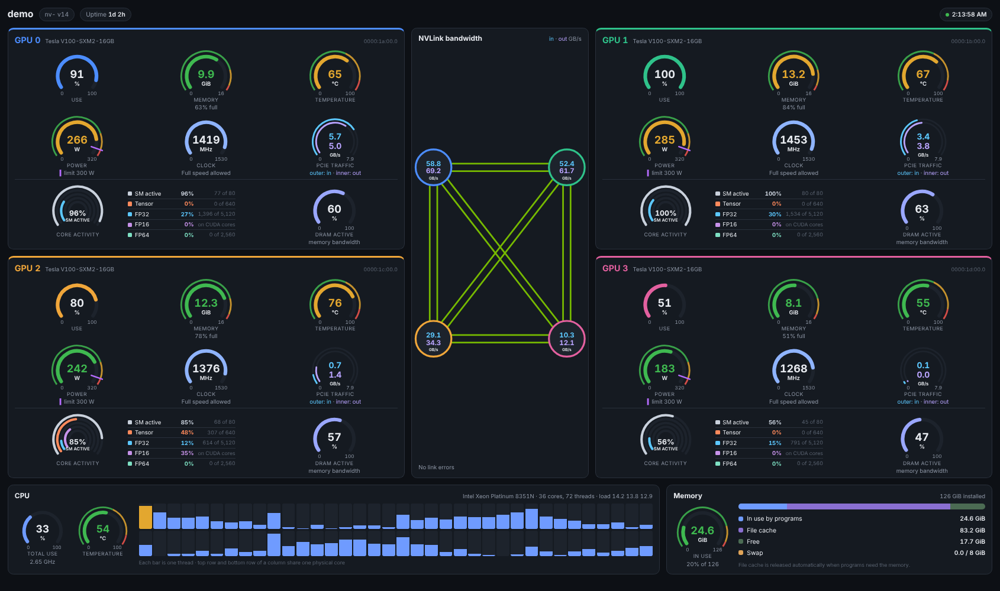
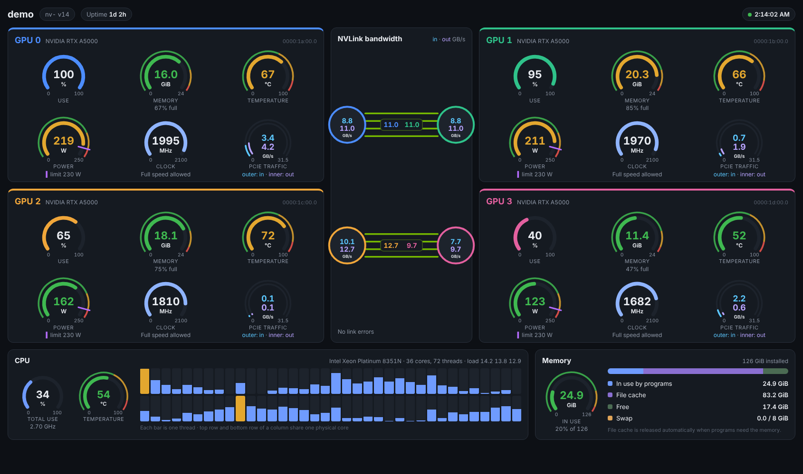
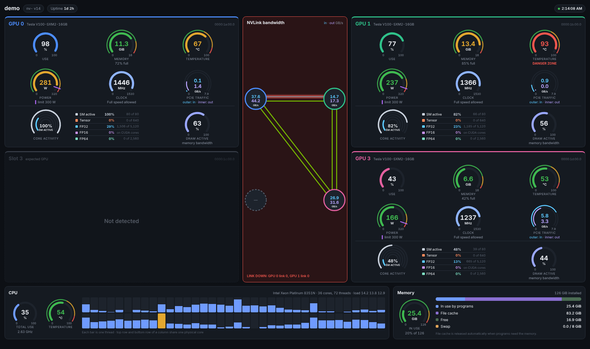

# nv-

A live web dashboard for NVIDIA GPUs on a Linux machine. It shows every GPU as a card of dials, the NVLink connections between them, and the CPU and memory of the machine, refreshing every couple of seconds in any browser on your network.




Short video from a live training test.

https://github.com/user-attachments/assets/ffa42ed9-1d2b-43e5-86d7-67c87456db18


It is two files: a small Python program (`server.py`) that reads the hardware, and one web page (`index.html`) that draws it. No database, no build step, nothing to configure.

## What it shows

**Each GPU**

- Use, memory, temperature, power, clock and PCIe traffic as dials
- Warning zones: temperature turns yellow at 60 °C and flashes red at 90 °C; memory turns yellow at 80 % and red at 95 %; power turns red above the card's configured limit (the purple line)
- Why the clock is held back, when it is: power limit, temperature or hardware
- Core activity (needs DCGM): how busy the SMs, tensor cores, FP32, FP16 and FP64 units are, with an estimate of how many cores that equals
- DRAM active (needs DCGM): how close the GPU is to its memory bandwidth limit

**NVLink** (when the GPUs have it)

- One green line per physical link between each pair of GPUs; a link that is down turns gray with a red glow, and the whole section turns red
- Each GPU's NVLink traffic in and out, in its circle (needs DCGM)
- Link error counts (replays, recoveries, CRC errors)

**The machine**

- CPU use per thread, total use, package temperature and load
- Memory in use by programs, file cache, free and swap

The page scales itself to fit the browser window.

## Layouts

The page arranges itself around what it finds:

| Machine | Layout |
|---|---|
| Four GPUs joined by NVLink (for example a V100 SXM2 board) | 2×2 cards with the NVLink diagram in the middle |
| Two GPUs joined by NVLink (for example a bridged pair) | Two cards side by side with the diagram between them |
| Two bridged pairs | 2×2 cards, each pair joined by its own links |
| NVLinked GPUs plus PCIe-only GPUs | NVLinked group on top, the others in a row below |
| No NVLink | Cards in a grid, no NVLink section |
| One GPU | One full-width card with all dials in a row |

On the V100, each circle shows that GPU's total NVLink traffic from DCGM. If a driver reports traffic per link, each GPU pair also gets a label on its lines: the number in each GPU's color is what that GPU sends (untested on real hardware so far).



## Supported GPUs

nv- is built and tested on Volta: Tesla V100 SXM2 GPUs on an NVLink board. It reads the standard NVIDIA interfaces, so other NVIDIA GPUs from Volta onward should work, but they have not been tested yet. Reports from other GPUs are welcome.

## Requirements

- Linux with an NVIDIA GPU and the NVIDIA driver installed (`nvidia-smi` works)
- Python 3.9 or newer
- The Python packages `psutil` and `nvidia-ml-py` (see `requirements.txt`)
- [NVIDIA DCGM](https://docs.nvidia.com/datacenter/dcgm/latest/installation.html) 4 with the `nvidia-dcgm` service running. On the V100 it is the only source of core activity, DRAM active and NVLink traffic, and without it those readings show a dash.

## Install

DCGM installs from NVIDIA's CUDA apt repository; if that repository is not set up yet, follow [NVIDIA's DCGM install guide](https://docs.nvidia.com/datacenter/dcgm/latest/installation.html) first. `<cudaMajor>` is the CUDA major version that `nvidia-smi` reports.

```
sudo apt install datacenter-gpu-manager-4-cuda<cudaMajor>
sudo systemctl enable --now nvidia-dcgm
git clone <repositoryUrl> nv-
python3 -m venv ~/envs/nv-
~/envs/nv-/bin/pip install -r nv-/requirements.txt
```

## Run

```
~/envs/nv-/bin/python nv-/server.py
```

Then open `http://<machine-address>:8090` in a browser.

To see the page without GPUs, run it with made-up numbers:

```
python3 server.py --demo
```

## Settings

| Setting | Default | What it does |
|---|---|---|
| `--port` | 8090 | Web port |
| `--host` | 0.0.0.0 | Network address to listen on; `127.0.0.1` keeps it to the machine itself |
| `--interval` | 2 | Seconds between readings |
| `--layout` | GPU order | Order of the GPU cards on screen, left to right, top to bottom, e.g. `0,1,2,3` |
| `--slots` | none | PCI bus number of each expected GPU in screen order, e.g. `1a,1b,1c,1d`; a GPU that goes missing shows as a grayed "Not detected" card in its place |
| `--simulate` | none | Show a warning without touching the hardware (see below); can be repeated |
| `--demo` | off | Made-up numbers, no GPUs needed |
| `--demo-layout` | 4nvlink | Demo machine: `4nvlink`, `2bridge`, `2pairs`, `1gpu`, `nolink`, `6gpu` |

`--layout` and `--slots` matter because NVIDIA numbers GPUs in PCIe order, which may not match where the cards physically sit, and renumbers them when one is missing. `nvidia-smi --query-gpu=index,pci.bus_id --format=csv` lists each GPU's bus number.

## Testing the warnings

`--simulate TEST=GPU:VALUE` changes only what the page shows, never the hardware. It works with real GPUs and with `--demo`.

| Test | Example | Shows |
|---|---|---|
| `link-down` | `link-down=0:3` | GPU 0's link 3 down: gray line with a red glow, NVLink section red |
| `temp` | `temp=1:93` | GPU 1 at 93 °C: flashing danger zone |
| `mem` | `mem=0:97` | GPU 0 memory 97 % full: red |
| `power` | `power=3:320` | GPU 3 drawing 320 W: red above the limit line |
| `held` | `held=3:power` or `held=3:heat` | GPU 3's clock held back |
| `nvlink-errors` | `nvlink-errors=1:5` | 5 link replays reported for GPU 1 |
| `drop` | `drop=2` | GPU 2 not detected (with `--slots`, a grayed card) |

```
python3 server.py --demo --slots 1a,1b,1c,1d --simulate drop=2 --simulate link-down=0:0 --simulate temp=1:93
```



## Start at boot

`nv-.service` is an example systemd service. Edit the user name and paths in it, then:

```
sudo cp nv-.service /etc/systemd/system/
sudo systemctl daemon-reload
sudo systemctl enable --now nv-
```

## Security

nv- has no login. Anyone who can reach the port can see the page (it is read-only; nothing on the page can change the machine). Run it on a trusted network, or set `--host 127.0.0.1` and reach it through an SSH tunnel.

## Known limits

- **NVLink traffic per link or per GPU pair** is not available on recent drivers for older GPUs such as the V100: NVIDIA retired the per-link counters, and their replacement is not reported for those cards. nv- shows each GPU's total NVLink traffic from DCGM instead, which does not say which link the traffic used.
- **DCGM takes turns** between readings it cannot take at the same time and reports the skipped ones as zero. nv- shows the highest of the last three readings for each value to smooth this out.
- **Core counts** for the "61 of 80" estimates are only filled in for the Tesla V100 so far. Other GPUs show percentages only; adding a model is one line in `CORE_COUNTS` in `index.html`.
- With NVLink groups other than a pair or four GPUs (for example three), the cards use a two-column grid with the diagram below.
- Core count estimates are filled in for Volta GPUs (V100) only; other GPUs show percentages.
- DCGM's core activity and DRAM readings need a data-center GPU from Volta onward; on other GPUs that row is left out.

## Where the numbers come from

| Reading | Source |
|---|---|
| Use, memory, temperature, power, clock, PCIe traffic, NVLink link status and errors | NVIDIA's management library (NVML), through `nvidia-ml-py` |
| Core activity, DRAM active, NVLink traffic | DCGM, through its `dcgmi dmon` command |
| CPU and memory | `psutil` |

## License

MIT, see `LICENSE`.
